# ACA – Programación Avanzada

# Sistema de Gestión de Biblioteca

------------------------------------------------------------------------

## PORTADA

**CORPORACIÓN UNIFICADA NACIONAL DE EDUCACIÓN SUPERIOR – CUN**

**Escuela de Ingenierías – Ingeniería de Sistemas**

**Programación Avanzada – NRC 54469 – Segundo bloque 26V04**

### ACA – Programación Avanzada

### Sistema de Gestión de Biblioteca

**Presentado por:**
John Andrés Mora Varón

**Docente:**
Verónica Castro

**Fecha:**
Colombia, noviembre de 2026

------------------------------------------------------------------------

## CONTRAPORTADA

**Sistema de Gestión de Biblioteca**

Proyecto desarrollado como evidencia del curso de **Programación Avanzada**, aplicando Programación Orientada a Objetos, base de datos relacional, arquitectura por capas, operaciones CRUD, validaciones, manejo de excepciones y conexión con SQL Server.

| | |
|---|---|
| **Estudiante** | John Andrés Mora Varón |
| **Programa** | Ingeniería de Sistemas (ciclo técnico) |
| **Asignatura** | Programación Avanzada (ISP01) |
| **Grupo** | NRC 54469 – Segundo bloque 26V04 |
| **Docente** | Verónica Castro |
| **Institución** | Corporación Unificada Nacional de Educación Superior – CUN |
| **Año** | 2026 |

------------------------------------------------------------------------

## TABLA DE CONTENIDO

> La numeración de páginas se genera al exportar este documento a PDF (ver *README.md*, sección «Exportar la documentación a PDF»).

1. [Introducción](#1-introducción)
2. [Objetivos](#2-objetivos)
   - 2.1 Objetivo general
   - 2.2 Objetivos específicos
3. [Planteamiento del problema](#3-planteamiento-del-problema)
4. [Análisis de requerimientos](#4-análisis-de-requerimientos)
5. [Casos de uso](#5-casos-de-uso)
6. [Diagrama de clases](#6-diagrama-de-clases)
7. [Modelo entidad-relación](#7-modelo-entidad-relación)
8. [Diccionario de datos](#8-diccionario-de-datos)
9. [Arquitectura del sistema](#9-arquitectura-del-sistema)
10. [Explicación de los módulos desarrollados](#10-explicación-de-los-módulos-desarrollados)
11. [Conexión con SQL Server](#11-conexión-con-sql-server)
12. [Capturas de pantalla del sistema](#12-capturas-de-pantalla-del-sistema)
13. [Pruebas de funcionamiento](#13-pruebas-de-funcionamiento)
14. [Conclusiones](#14-conclusiones)
15. [Recomendaciones](#15-recomendaciones)
16. [Referencias bibliográficas](#16-referencias-bibliográficas)
17. [Anexos](#anexos)

------------------------------------------------------------------------

# 1. INTRODUCCIÓN

El presente documento describe el desarrollo del **Sistema de Gestión de Biblioteca**, una aplicación de escritorio cuyo propósito es facilitar la administración de los procesos de la biblioteca de una institución educativa: el registro de libros, autores, editoriales y usuarios, el control de préstamos y devoluciones y la consulta de información mediante reportes.

El sistema fue desarrollado con **C#, .NET 10, Windows Forms y SQL Server 2022**, utilizando ADO.NET (`Microsoft.Data.SqlClient`) para el acceso a datos. Aplica los principios de la Programación Orientada a Objetos (clases, constructores, encapsulamiento, herencia y polimorfismo) y una **arquitectura por capas** con cuatro proyectos independientes: Entidades, Acceso a Datos, Lógica de Negocio y Presentación.

La aplicación permite gestionar libros, autores, editoriales y usuarios (registrar, consultar, editar y eliminar), registrar préstamos controlando las existencias de cada libro, registrar devoluciones, consultar el estado de los préstamos y generar diez reportes consolidados que pueden exportarse a CSV. Todas las operaciones validan los datos antes de guardarlos, utilizan consultas parametrizadas y respetan las restricciones de integridad de la base de datos.

------------------------------------------------------------------------

# 2. OBJETIVOS

## 2.1 Objetivo general

Desarrollar un Sistema de Gestión de Biblioteca de escritorio que permita administrar libros, autores, editoriales y usuarios, gestionar préstamos y devoluciones y generar reportes, utilizando C#, Windows Forms y SQL Server, aplicando Programación Orientada a Objetos y una arquitectura por capas.

## 2.2 Objetivos específicos

- Diseñar e implementar una base de datos relacional en SQL Server con claves primarias, foráneas y restricciones de integridad (`UNIQUE`, `CHECK`, `DEFAULT`).
- Aplicar los principios de Programación Orientada a Objetos mediante clases de entidad con constructores, propiedades encapsuladas, herencia (`EntidadBase` → `Persona` → `Autor` / `Usuario`) y polimorfismo (`Validar()` y `ToString()`).
- Implementar operaciones CRUD para libros, autores, editoriales y usuarios.
- Controlar los préstamos y devoluciones actualizando las existencias de los libros mediante transacciones.
- Implementar una arquitectura por capas que separe la presentación, la lógica de negocio y el acceso a datos.
- Validar la información ingresada y manejar las excepciones con mensajes claros para el usuario.
- Implementar un módulo de reportes con consultas multi-tabla (`JOIN`, `GROUP BY`).
- Utilizar Git y GitHub para el control de versiones del proyecto.
- Documentar técnica y funcionalmente el sistema.

------------------------------------------------------------------------

# 3. PLANTEAMIENTO DEL PROBLEMA

## 3.1 Descripción del problema

Una institución educativa requiere una aplicación de escritorio que facilite la administración de los procesos de su biblioteca. Actualmente la gestión de libros, autores, editoriales y usuarios, así como el control de préstamos y devoluciones, no cuenta con un sistema organizado: la información se maneja de forma dispersa, lo que puede generar registros duplicados, pérdida de información, desconocimiento de la disponibilidad real de los ejemplares y dificultad para saber qué usuario tiene cada libro.

Para atender esta necesidad se desarrolló un Sistema de Gestión de Biblioteca que centraliza la información bibliográfica, administra los usuarios, controla los préstamos y devoluciones y permite consultar la información mediante reportes, garantizando la integridad y consistencia de los datos almacenados.

## 3.2 Justificación

El sistema aporta los siguientes beneficios:

- **Información centralizada y confiable:** todos los registros quedan en una sola base de datos con reglas que impiden duplicados e inconsistencias.
- **Control de disponibilidad:** cada préstamo descuenta un ejemplar y cada devolución lo repone automáticamente, por lo que el bibliotecario sabe en todo momento cuántos ejemplares hay disponibles.
- **Trazabilidad:** el historial de préstamos permite saber quién tiene o tuvo cada libro y en qué fechas.
- **Toma de decisiones:** los reportes muestran préstamos activos, libros más prestados, usuarios con préstamos pendientes y el inventario.
- **Mantenibilidad:** la arquitectura por capas facilita corregir, ampliar o cambiar partes del sistema sin afectar las demás.

## 3.3 Alcance

El sistema permite:

- Navegar entre los módulos desde un formulario principal con menú lateral.
- Consultar un resumen general de la biblioteca en la pantalla de Inicio.
- Gestionar libros (registrar, consultar, editar, eliminar y buscar por título, ISBN o autor).
- Gestionar autores, editoriales y usuarios (registrar, consultar, editar y eliminar).
- Registrar préstamos, editarlos mientras estén activos y eliminarlos.
- Registrar devoluciones.
- Consultar y filtrar los préstamos por estado (Prestado / Devuelto) y por usuario, título o ISBN.
- Generar diez reportes y exportarlos a CSV.

### Fuera del alcance

Las siguientes funcionalidades **no** forman parte de esta versión:

- Inicio de sesión, usuarios del sistema y roles.
- Cálculo de multas por retraso y fecha estimada de devolución.
- Préstamo de varios libros en un mismo registro (cada préstamo corresponde a un libro, por lo que no se usa una tabla `DetallePrestamo`).
- Tabla independiente de categorías (la categoría se guarda como texto en la tabla `Libros`).
- Reservas de libros y notificaciones a los usuarios.

------------------------------------------------------------------------

# 4. ANÁLISIS DE REQUERIMIENTOS

## 4.1 Descripción general

El Sistema de Gestión de Biblioteca administra la información de **libros, autores, editoriales, usuarios y préstamos**, y controla los procesos de **préstamo, devolución, consulta de disponibilidad y generación de reportes**.

## 4.2 Actores del sistema

| Actor | Descripción |
|---|---|
| Bibliotecario / Administrador | Único usuario de la aplicación. Registra y mantiene la información de libros, autores, editoriales y usuarios; registra préstamos y devoluciones, y consulta reportes. |

> Los usuarios de la biblioteca (estudiantes, docentes) no interactúan directamente con la aplicación: son registrados y atendidos por el bibliotecario.

## 4.3 Requerimientos funcionales

| Código | Requerimiento | Descripción | Implementación |
|---|---|---|---|
| RF01 | Gestión de libros | Registrar, consultar, editar y eliminar libros; buscar por título, ISBN o autor; relacionar cada libro con su autor y editorial; consultar existencias. | `FrmLibros`, `LibroNegocio`, `LibroDAO` |
| RF02 | Gestión de autores | Registrar, consultar, editar y eliminar autores (si no tienen libros asociados). | `FrmAutores`, `AutorNegocio`, `AutorDAO` |
| RF03 | Gestión de editoriales | Registrar, consultar, editar y eliminar editoriales (si no tienen libros asociados). | `FrmEditoriales`, `EditorialNegocio`, `EditorialDAO` |
| RF04 | Gestión de usuarios | Registrar, consultar, editar y eliminar usuarios con nombre, apellido, documento, teléfono y correo. | `FrmUsuarios`, `UsuarioNegocio`, `UsuarioDAO` |
| RF05 | Gestión de préstamos | Registrar préstamos seleccionando usuario y libro, con fecha; consultar, filtrar, editar (si están activos) y eliminar préstamos; consultar su estado. | `FrmPrestamos`, `PrestamoNegocio`, `PrestamoDAO` |
| RF06 | Gestión de devoluciones | Registrar la devolución: guarda la fecha, cambia el estado a «Devuelto» y suma una existencia al libro. | `FrmPrestamos` (botón Devolución) |
| RF07 | Consultas y reportes | Generar 10 reportes consolidados y exportarlos a CSV. | `FrmReportes`, `ReporteNegocio`, `ReporteDAO` |
| RF08 | Navegación del sistema | Formulario principal con acceso a Inicio, Libros, Usuarios, Autores, Editoriales, Préstamos y Reportes. | `FrmPrincipal`, `FrmInicio` |

## 4.4 Requerimientos no funcionales

| Código | Requerimiento | Descripción | Cómo se cumple |
|---|---|---|---|
| RNF01 | Usabilidad | Interfaz clara, organizada y fácil de utilizar. | Menú lateral, títulos por módulo, controles agrupados y tablas de solo lectura con selección por fila. |
| RNF02 | Validación | Validar los campos obligatorios, tipos, longitudes y formatos. | Método `Validar()` de cada entidad y reglas en la capa de negocio. |
| RNF03 | Unicidad | Prevenir registros duplicados. | Restricciones `UNIQUE` en la BD y verificación previa en la capa de negocio. |
| RNF04 | Mensajes | Informar el resultado de cada operación y los errores. | Clase `Mensajes` (información, advertencia, error y confirmación). |
| RNF05 | Manejo de excepciones | Las operaciones manejan los errores de forma controlada. | `try/catch` en todos los eventos; `ReglaNegocioException` para reglas y traducción de errores SQL 2627, 2601 y 547. |
| RNF06 | Integridad de datos | La información se mantiene consistente. | Claves foráneas, `CHECK`, transacciones en préstamos y devoluciones. |
| RNF07 | Consultas parametrizadas | Todo acceso a la BD usa parámetros. | Todas las consultas de la capa de datos usan `SqlParameter`. |
| RNF08 | Arquitectura | Separación entre interfaz y acceso a datos. | Cuatro proyectos: Presentación, Negocio, Datos y Entidades. |
| RNF09 | Mantenibilidad | Código organizado, legible y con nombres descriptivos. | Comentarios XML (`///`), nombres descriptivos de clases, métodos y controles. |

## 4.5 Reglas de negocio

| Código | Regla | Dónde se valida |
|---|---|---|
| RN01 | No se permiten dos libros con el mismo **ISBN** (clave primaria). El ISBN debe tener 10 o 13 dígitos. | `Libro.Validar()`, `LibroNegocio.Registrar()` |
| RN02 | No se permiten registros con **campos obligatorios vacíos** ni que superen la longitud definida en la BD. | `Validar()` de cada entidad |
| RN03 | No se permiten dos usuarios con el mismo **documento**. | `UsuarioNegocio`, `UQ_Usuarios_Documento` |
| RN04 | No se permiten autores repetidos (mismo nombre y apellido) ni editoriales con el mismo nombre. | `AutorNegocio`, `EditorialNegocio`, restricciones `UNIQUE` |
| RN05 | El correo, si se ingresa, debe tener formato válido; el teléfono solo admite números, espacios, `+` y `-`. | `Usuario.Validar()` |
| RN06 | Un libro debe estar asociado a un **autor y una editorial existentes**. | `LibroNegocio`, claves foráneas |
| RN07 | No se puede registrar un préstamo para un **usuario o libro inexistente**. | `PrestamoNegocio`, claves foráneas |
| RN08 | No se puede prestar un libro **sin existencias**. | `PrestamoDAO.Registrar()` (`Existencias > 0`), `CK_Libros_Existencias` |
| RN09 | Al registrar un préstamo se **descuenta** una existencia; al devolverlo se **suma**. Ambas operaciones se realizan en una transacción. | `PrestamoDAO` |
| RN10 | Un usuario no puede tener **dos préstamos activos del mismo libro**. | `PrestamoNegocio` |
| RN11 | La fecha de préstamo no puede ser futura y la de devolución no puede ser anterior al préstamo ni futura. | `Prestamo.Validar()`, `CK_Prestamos_Fechas` |
| RN12 | Un préstamo **Prestado** no tiene fecha de devolución y uno **Devuelto** sí la tiene. | `CK_Prestamos_EstadoFecha` |
| RN13 | Solo se pueden **editar** préstamos activos. Si se cambia el libro, la existencia se devuelve al anterior y se descuenta del nuevo. | `PrestamoNegocio.Actualizar()` |
| RN14 | Al **eliminar** un préstamo activo, el ejemplar vuelve a quedar disponible. | `PrestamoDAO.Eliminar()` |
| RN15 | No se pueden eliminar autores, editoriales, libros o usuarios que tengan registros relacionados. | Capa de negocio y claves foráneas |

------------------------------------------------------------------------

# 5. CASOS DE USO

## 5.1 Descripción

El bibliotecario es el único actor. Interactúa con el sistema para mantener los catálogos (libros, autores, editoriales y usuarios), registrar los préstamos y devoluciones y consultar la información de la biblioteca.

## 5.2 Diagrama de casos de uso

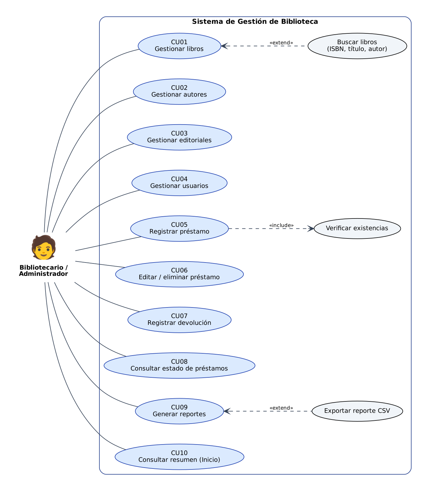

## 5.3 Descripción de casos de uso

### CU01 – Gestionar libros

**Actor principal:** Bibliotecario / Administrador

**Descripción:** Permite registrar, consultar, actualizar, eliminar y buscar libros.

**Precondiciones:**
- Deben existir autores y editoriales registrados.

**Flujo principal:**
1. El actor ingresa al módulo **Libros**.
2. El sistema muestra los libros registrados con su autor, editorial y existencias.
3. El actor diligencia ISBN, título, autor, editorial, categoría, año y existencias, y presiona **Guardar**; o hace doble clic sobre un libro y presiona **Editar** o **Eliminar**.
4. El sistema valida los datos y las reglas de negocio.
5. El sistema guarda los cambios, muestra un mensaje de confirmación y actualiza la tabla.

**Flujos alternativos:**
- ISBN repetido o con formato inválido: se muestra una advertencia y no se guarda.
- Campos obligatorios vacíos, año o existencias no numéricos: se indica el campo con error.
- Libro con préstamos registrados: no se permite eliminarlo.
- **Buscar (extensión):** el actor elige el criterio (Título, ISBN o Autor), escribe el texto y presiona **Buscar**; si hay un solo resultado se carga en el formulario.

**Postcondiciones:** el libro queda registrado, actualizado o eliminado en la base de datos.

------------------------------------------------------------------------

### CU02 – Gestionar autores / CU03 – Gestionar editoriales / CU04 – Gestionar usuarios

**Actor principal:** Bibliotecario / Administrador

**Descripción:** Permiten registrar, consultar, actualizar y eliminar autores, editoriales y usuarios.

**Flujo principal:**
1. El actor ingresa al módulo correspondiente.
2. El sistema lista los registros existentes.
3. El actor diligencia los datos y presiona **Guardar**, o hace doble clic sobre un registro y presiona **Editar** o **Eliminar**.
4. El sistema valida los datos, aplica las reglas y confirma la operación.

**Flujos alternativos:**
- Autor o editorial duplicados, o documento de usuario repetido: no se guarda.
- Correo o teléfono con formato inválido (usuarios): se muestra la advertencia.
- Autor o editorial con libros asociados, o usuario con préstamos: no se permite eliminar.

**Postcondiciones:** el registro queda guardado, actualizado o eliminado.

------------------------------------------------------------------------

### CU05 – Registrar préstamo

**Actor principal:** Bibliotecario / Administrador

**Descripción:** Permite registrar el préstamo de un libro a un usuario.

**Precondiciones:**
- El usuario debe existir.
- El libro debe existir y tener al menos un ejemplar disponible.

**Flujo principal:**
1. El actor ingresa al módulo **Préstamos** y presiona **Nuevo**.
2. Selecciona el usuario y el libro; el sistema muestra los ejemplares disponibles.
3. Selecciona la fecha del préstamo y presiona **Guardar**.
4. El sistema verifica las reglas (usuario y libro existentes, fecha válida, sin préstamo activo repetido).
5. En una transacción, descuenta una existencia y registra el préstamo con estado **Prestado**.
6. Muestra la confirmación y actualiza la tabla.

**Flujos alternativos:**
- Libro sin existencias: no se registra el préstamo.
- El usuario ya tiene ese libro prestado: no se registra.
- Fecha de préstamo futura: no se registra.

**Postcondiciones:** el préstamo queda registrado y la existencia del libro disminuye en 1.

------------------------------------------------------------------------

### CU06 – Editar / eliminar préstamo

**Flujo principal:** el actor hace doble clic en un préstamo, modifica usuario, libro o fecha y presiona **Editar**; o presiona **Eliminar** y confirma.

**Flujos alternativos:**
- El préstamo ya fue devuelto: no se permite editarlo.
- El nuevo libro no tiene existencias: no se actualiza.

**Postcondiciones:** si se cambió el libro, las existencias de ambos libros quedan ajustadas; si se eliminó un préstamo activo, el ejemplar vuelve a estar disponible.

------------------------------------------------------------------------

### CU07 – Registrar devolución

**Actor principal:** Bibliotecario / Administrador

**Precondiciones:** debe existir un préstamo con estado **Prestado**.

**Flujo principal:**
1. El actor hace doble clic sobre el préstamo en la tabla.
2. Marca la casilla **Fecha Devolución** y selecciona la fecha.
3. Presiona **Devolución** y confirma.
4. En una transacción, el sistema guarda la fecha, cambia el estado a **Devuelto** y suma una existencia al libro.
5. Muestra la confirmación y actualiza la tabla.

**Flujos alternativos:**
- El préstamo ya estaba devuelto: se muestra una advertencia.
- No se marcó la fecha de devolución, o es anterior al préstamo: no se registra.

**Postcondiciones:** el préstamo queda en estado Devuelto y el libro vuelve a estar disponible.

------------------------------------------------------------------------

### CU08 – Consultar estado de préstamos

El actor filtra los préstamos por estado (Todos, Prestado, Devuelto) y por texto (usuario, título o ISBN). Los préstamos activos se muestran en rojo y los devueltos en verde.

### CU09 – Generar reportes

El actor selecciona el tipo de reporte, presiona **Generar Reporte** y puede exportarlo a CSV (extensión). Se muestra el total de registros.

### CU10 – Consultar resumen

Al abrir la aplicación o el módulo **Inicio**, el sistema muestra el total de títulos, ejemplares disponibles, usuarios, autores, editoriales, préstamos activos y devueltos.

------------------------------------------------------------------------

# 6. DIAGRAMA DE CLASES

## 6.1 Descripción

Las clases del sistema se organizan en cuatro proyectos (capas). La capa de **Entidades** contiene las clases del dominio; la capa de **Negocio** contiene una clase por módulo con las reglas; la capa de **Datos** contiene una clase DAO (*Data Access Object*) por tabla, y la capa de **Presentación** contiene los formularios.

## 6.2 Diagrama de clases – Entidades

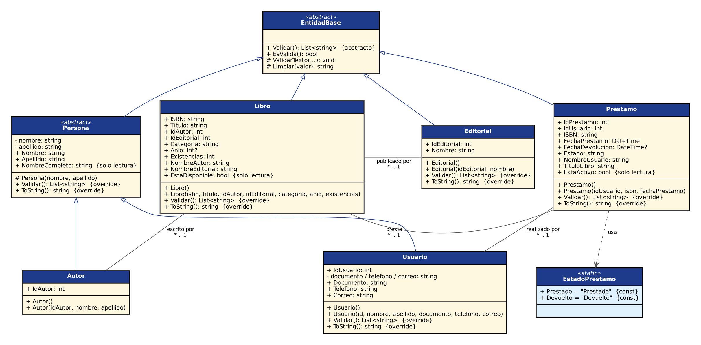

## 6.3 Diagrama de clases – Capas de negocio y datos

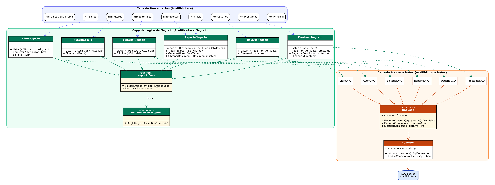

## 6.4 Principales clases

| Clase | Capa | Responsabilidad |
|---|---|---|
| `EntidadBase` (abstracta) | Entidades | Define el método abstracto `Validar()` y utilidades comunes de validación. |
| `Persona` (abstracta) | Entidades | Agrupa Nombre, Apellido, NombreCompleto y su validación. |
| `Autor` | Entidades | Representa un autor (hereda de `Persona`). |
| `Usuario` | Entidades | Representa un usuario de la biblioteca (hereda de `Persona` y amplía la validación). |
| `Editorial` | Entidades | Representa una editorial. |
| `Libro` | Entidades | Representa un libro y su disponibilidad. |
| `Prestamo` / `EstadoPrestamo` | Entidades | Representa un préstamo y los estados permitidos. |
| `ResumenBiblioteca` | Entidades | Indicadores de la pantalla de Inicio. |
| `Conexion` | Datos | Cadena de conexión y prueba de conexión con SQL Server. |
| `DaoBase` (abstracta) | Datos | Ejecuta consultas parametrizadas (consulta, comando y escalar). |
| `LibroDAO`, `AutorDAO`, `EditorialDAO`, `UsuarioDAO` | Datos | CRUD de cada tabla. |
| `PrestamoDAO` | Datos | Préstamos, devoluciones y existencias mediante transacciones. |
| `ReporteDAO` | Datos | Consultas consolidadas de los reportes. |
| `NegocioBase` (abstracta) | Negocio | Validación polimórfica de entidades y traducción de errores SQL. |
| `ReglaNegocioException` | Negocio | Excepción propia para las reglas de negocio. |
| `LibroNegocio`, `AutorNegocio`, `EditorialNegocio`, `UsuarioNegocio`, `PrestamoNegocio`, `ReporteNegocio` | Negocio | Reglas y coordinación de cada módulo. |
| `FrmPrincipal`, `FrmInicio`, `FrmLibros`, `FrmAutores`, `FrmEditoriales`, `FrmUsuarios`, `FrmPrestamos`, `FrmReportes` | Presentación | Interfaz gráfica de cada módulo. |
| `Mensajes`, `EstiloTabla` | Presentación | Mensajes uniformes y formato de los `DataGridView`. |

## 6.5 Aplicación de POO

| Concepto | Aplicación en el proyecto |
|---|---|
| **Clases** | Una clase por entidad (`Libro`, `Autor`…), por DAO, por clase de negocio y por formulario. |
| **Objetos** | Los formularios crean objetos con los datos ingresados, por ejemplo `new Autor(id, txtNombre.Text, txtApellido.Text)`, y los envían a la capa de negocio. |
| **Constructores** | Cada entidad tiene un constructor vacío y uno con parámetros; `Persona` usa un constructor `protected` que llaman `Autor` y `Usuario` con `: base(nombre, apellido)`. |
| **Encapsulamiento** | Campos `private` (`nombre`, `documento`, `correo`…) expuestos mediante propiedades que limpian el valor (`Trim`, minúsculas en correo, ISBN sin guiones). Los métodos auxiliares de validación son `protected` y los de apoyo de los DAO son `private`. |
| **Propiedades** | Propiedades de lectura y escritura (`Titulo`, `Existencias`) y propiedades calculadas de solo lectura (`NombreCompleto`, `EstaDisponible`, `EstaActivo`). |
| **Métodos** | `Validar()`, `Registrar()`, `Actualizar()`, `Eliminar()`, `RegistrarDevolucion()`, `Generar()`… |
| **Colecciones** | Los DAO devuelven `List<Libro>`, `List<Usuario>`, etc., que se enlazan a los `DataGridView` y `ComboBox`. `ReporteNegocio` usa un `Dictionary<string, Func<DataTable>>` que asocia cada nombre de reporte con su consulta. |
| **Herencia** | `Autor` y `Usuario` heredan de `Persona`, que hereda de `EntidadBase`; `Libro`, `Editorial` y `Prestamo` heredan de `EntidadBase`. Los DAO heredan de `DaoBase`, las clases de negocio de `NegocioBase`, y `ReglaNegocioException` de `Exception`. **Justificación:** se evita repetir código (nombre/apellido, ejecución de consultas, validación y manejo de errores). |
| **Polimorfismo** | `EntidadBase.Validar()` es abstracto y cada entidad lo implementa (`override`); `Usuario.Validar()` amplía el de `Persona` con `base.Validar()`. `NegocioBase.ValidarEntidad(EntidadBase entidad)` recibe cualquier entidad y ejecuta su validación propia. `ToString()` se sobrescribe para que los `ComboBox` de préstamos muestren «Ana Pérez - 1001001001» o «1984 (4 disp.)». |
| **Manejo de excepciones** | Excepción propia `ReglaNegocioException` (advertencias) diferenciada de errores inesperados (`Exception`), filtros `catch … when` para los errores de SQL y `Rollback` de las transacciones. |

------------------------------------------------------------------------

# 7. MODELO ENTIDAD-RELACIÓN

## 7.1 Descripción

La base de datos **AcaBiblioteca** está normalizada hasta la tercera forma normal (3FN): cada tabla representa una sola entidad, todos los atributos dependen solo de su clave primaria y no hay dependencias transitivas. Se obtienen cinco tablas relacionadas: **Autores, Editoriales, Libros, Usuarios y Prestamos**.

## 7.2 Diagrama entidad-relación

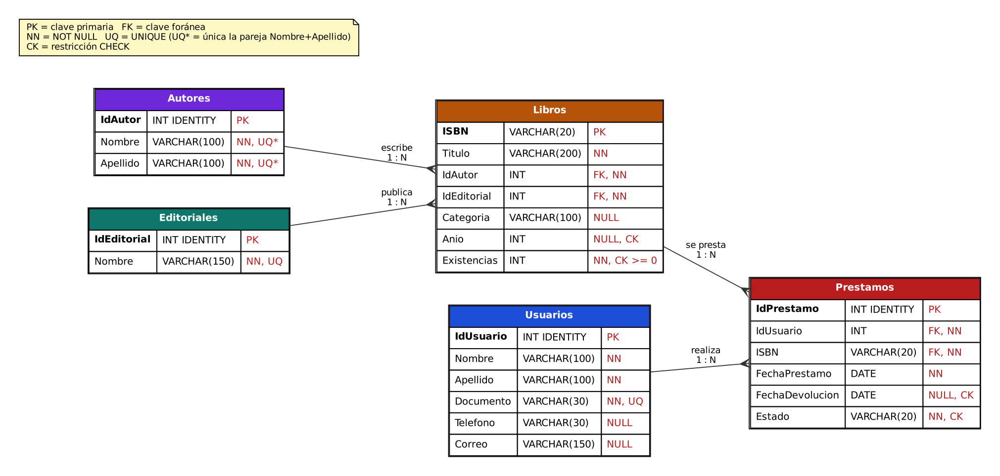

## 7.3 Relaciones principales

| Relación | Cardinalidad | Clave foránea |
|---|---|---|
| Un **autor** escribe muchos **libros**; cada libro tiene un autor. | 1 : N | `Libros.IdAutor` → `Autores.IdAutor` |
| Una **editorial** publica muchos **libros**; cada libro tiene una editorial. | 1 : N | `Libros.IdEditorial` → `Editoriales.IdEditorial` |
| Un **usuario** realiza muchos **préstamos**; cada préstamo es de un usuario. | 1 : N | `Prestamos.IdUsuario` → `Usuarios.IdUsuario` |
| Un **libro** se presta muchas veces; cada préstamo corresponde a un libro. | 1 : N | `Prestamos.ISBN` → `Libros.ISBN` |

> Cada préstamo corresponde a un solo libro, por lo que el modelo no necesita una tabla `DetallePrestamo`.

------------------------------------------------------------------------

# 8. DICCIONARIO DE DATOS

## 8.1 Convenciones

| Abreviatura | Significado |
|---|---|
| PK | Clave primaria |
| FK | Clave foránea |
| UQ | Campo con valor único |
| CK | Restricción de verificación (`CHECK`) |
| DF | Valor por defecto (`DEFAULT`) |
| NULL | Campo que puede estar vacío |
| NOT NULL | Campo obligatorio |

## 8.2 Tabla: Autores

| Campo | Tipo de dato | Clave | Nulo | Descripción |
|---|---|---|---|---|
| IdAutor | INT IDENTITY(1,1) | PK | No | Identificador único del autor (autonumérico). |
| Nombre | VARCHAR(100) | UQ* | No | Nombre(s) del autor. |
| Apellido | VARCHAR(100) | UQ* | No | Apellido(s) del autor. |

\* `UQ_Autores_NombreApellido`: la combinación Nombre + Apellido no se puede repetir.

## 8.3 Tabla: Editoriales

| Campo | Tipo de dato | Clave | Nulo | Descripción |
|---|---|---|---|---|
| IdEditorial | INT IDENTITY(1,1) | PK | No | Identificador único de la editorial. |
| Nombre | VARCHAR(150) | UQ | No | Nombre de la editorial (`UQ_Editoriales_Nombre`). |

## 8.4 Tabla: Libros

| Campo | Tipo de dato | Clave | Nulo | Descripción |
|---|---|---|---|---|
| ISBN | VARCHAR(20) | PK | No | Código único internacional del libro. |
| Titulo | VARCHAR(200) | – | No | Título del libro. |
| IdAutor | INT | FK | No | Autor del libro (`FK_Libros_Autores`). |
| IdEditorial | INT | FK | No | Editorial del libro (`FK_Libros_Editoriales`). |
| Categoria | VARCHAR(100) | – | Sí | Género o categoría (Novela, Cuentos…). |
| Anio | INT | CK | Sí | Año de publicación, entre 1000 y 2100 (`CK_Libros_Anio`). |
| Existencias | INT | CK, DF | No | Ejemplares disponibles para préstamo; nunca negativo (`CK_Libros_Existencias`); por defecto 0. |

## 8.5 Tabla: Usuarios

| Campo | Tipo de dato | Clave | Nulo | Descripción |
|---|---|---|---|---|
| IdUsuario | INT IDENTITY(1,1) | PK | No | Identificador único del usuario. |
| Nombre | VARCHAR(100) | – | No | Nombre(s) del usuario. |
| Apellido | VARCHAR(100) | – | No | Apellido(s) del usuario. |
| Documento | VARCHAR(30) | UQ | No | Número de documento (`UQ_Usuarios_Documento`). |
| Telefono | VARCHAR(30) | – | Sí | Teléfono de contacto. |
| Correo | VARCHAR(150) | – | Sí | Correo electrónico. |

## 8.6 Tabla: Prestamos

| Campo | Tipo de dato | Clave | Nulo | Descripción |
|---|---|---|---|---|
| IdPrestamo | INT IDENTITY(1,1) | PK | No | Identificador único del préstamo. |
| IdUsuario | INT | FK | No | Usuario que recibe el libro (`FK_Prestamos_Usuarios`). |
| ISBN | VARCHAR(20) | FK | No | Libro prestado (`FK_Prestamos_Libros`). |
| FechaPrestamo | DATE | – | No | Fecha en que se prestó el libro. |
| FechaDevolucion | DATE | CK | Sí | Fecha de devolución; vacía mientras el préstamo está activo y nunca anterior a la fecha del préstamo (`CK_Prestamos_Fechas`). |
| Estado | VARCHAR(20) | CK, DF | No | `Prestado` o `Devuelto` (`CK_Prestamos_Estado`); por defecto `Prestado`. Debe ser coherente con la fecha de devolución (`CK_Prestamos_EstadoFecha`). |

## 8.7 Índices

| Índice | Tabla (columna) | Propósito |
|---|---|---|
| IX_Libros_Titulo | Libros (Titulo) | Búsqueda por título y ordenamiento. |
| IX_Libros_IdAutor | Libros (IdAutor) | Búsqueda por autor y verificación al eliminar autores. |
| IX_Prestamos_Estado | Prestamos (Estado) | Filtro de préstamos activos / devueltos. |
| IX_Prestamos_IdUsuario | Prestamos (IdUsuario) | Historial por usuario. |
| IX_Prestamos_ISBN | Prestamos (ISBN) | Historial por libro y libros más prestados. |

------------------------------------------------------------------------

# 9. ARQUITECTURA DEL SISTEMA

## 9.1 Descripción general

El sistema utiliza una **arquitectura por capas**, separada **físicamente** en cuatro proyectos dentro de la solución `AcaBiblioteca.slnx`. Cada capa solo conoce a la capa inmediatamente inferior: los formularios nunca ejecutan SQL y los DAO nunca muestran mensajes.

| Proyecto | Capa | Depende de |
|---|---|---|
| `AcaBiblioteca` | Presentación (Windows Forms) | Negocio, Entidades |
| `AcaBiblioteca.Negocio` | Lógica de negocio | Datos, Entidades |
| `AcaBiblioteca.Datos` | Acceso a datos | Entidades, `Microsoft.Data.SqlClient` |
| `AcaBiblioteca.Entidades` | Entidades (modelo de dominio) | Ninguno |

## 9.2 Diagrama de arquitectura

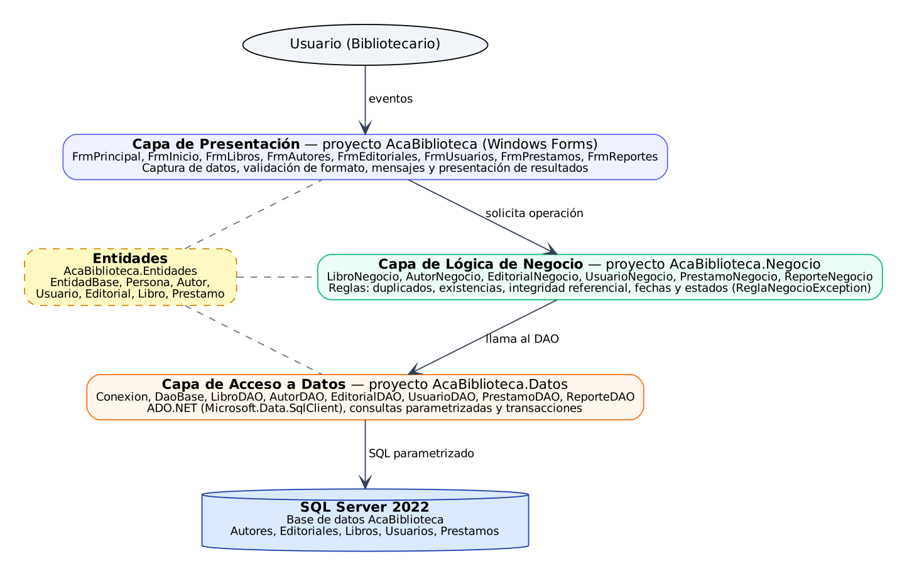

## 9.3 Capa de Presentación

**Responsabilidad:** interacción con el usuario: captura de datos, validación inicial de formato (por ejemplo, que el año sea numérico), presentación de resultados y mensajes.

**Componentes:** `FrmPrincipal`, `FrmInicio`, `FrmLibros`, `FrmAutores`, `FrmEditoriales`, `FrmUsuarios`, `FrmPrestamos`, `FrmReportes`, y las utilidades `Mensajes` y `EstiloTabla`.

**Tecnología:** C#, Windows Forms, .NET 10, FontAwesome.Sharp (íconos del menú).

## 9.4 Capa de Lógica de Negocio

**Responsabilidad:** aplicar las reglas del sistema, validar las operaciones y coordinar los procesos de cada módulo.

**Componentes:** `NegocioBase`, `ReglaNegocioException`, `LibroNegocio`, `AutorNegocio`, `EditorialNegocio`, `UsuarioNegocio`, `PrestamoNegocio`, `ReporteNegocio`.

**Ejemplos de reglas:** validar existencias, verificar que el usuario y el libro existan, impedir duplicados, impedir eliminar registros relacionados, validar fechas y mantener la coherencia entre estado y fecha de devolución.

## 9.5 Capa de Acceso a Datos

**Responsabilidad:** gestionar la comunicación con SQL Server.

**Componentes:** `Conexion`, `DaoBase`, `LibroDAO`, `AutorDAO`, `EditorialDAO`, `UsuarioDAO`, `PrestamoDAO`, `ReporteDAO`.

**Tecnologías:** SQL Server 2022, ADO.NET con `Microsoft.Data.SqlClient`, consultas parametrizadas y transacciones (`SqlTransaction`).

## 9.6 Capa de Base de Datos

**Base de datos:** `AcaBiblioteca` (script `BaseDatos/AcaBiblioteca.sql`).

**Tablas:** Autores, Editoriales, Libros, Usuarios y Prestamos, con claves primarias, foráneas, restricciones `UNIQUE`, `CHECK`, `DEFAULT` e índices.

## 9.7 Flujo de información

```text
Usuario
   ↓  (clic en Guardar)
Presentación      FrmPrestamos crea un objeto Prestamo con los datos del formulario
   ↓
Lógica de Negocio PrestamoNegocio.Registrar(): Validar(), usuario y libro existen,
   ↓              sin préstamo activo repetido
Acceso a Datos    PrestamoDAO.Registrar(): transacción → descuenta existencia → INSERT
   ↓
SQL Server        Verifica claves foráneas y restricciones CHECK
```

Las respuestas de la base de datos realizan el recorrido inverso. Si una regla no se cumple, la capa de negocio lanza una `ReglaNegocioException` y el formulario la muestra como advertencia.

## 9.8 Estructura de carpetas

```text
AcaBiblioteca/
├── AcaBiblioteca.slnx                 Solución de Visual Studio
├── AcaBiblioteca/                     Capa de Presentación (Windows Forms)
│   ├── FrmPrincipal.cs / FrmInicio.cs / FrmLibros.cs / FrmAutores.cs
│   ├── FrmEditoriales.cs / FrmUsuarios.cs / FrmPrestamos.cs / FrmReportes.cs
│   ├── Utilidades/ (Mensajes.cs, EstiloTabla.cs)
│   └── Resources/ (logo)
├── AcaBiblioteca.Negocio/             Capa de Lógica de Negocio
├── AcaBiblioteca.Datos/               Capa de Acceso a Datos
├── AcaBiblioteca.Entidades/           Entidades (POO)
├── BaseDatos/AcaBiblioteca.sql        Script de la base de datos
├── Documentacion/                     Este documento, diagramas y capturas
└── README.md
```

------------------------------------------------------------------------

# 10. EXPLICACIÓN DE LOS MÓDULOS DESARROLLADOS

## 10.1 Módulo principal y navegación (FrmPrincipal)

**Objetivo:** ofrecer un punto de acceso único a todos los módulos.

**Funcionalidades:** menú lateral con Inicio, Libros, Usuarios, Autores, Editoriales, Préstamos, Reportes y Salir; cada módulo se abre dentro del panel central (`AbrirFormulario`). La barra superior muestra el módulo activo y la fecha, y la barra inferior indica si hay conexión con SQL Server.

## 10.2 Módulo de inicio (FrmInicio)

**Objetivo:** mostrar un resumen general de la biblioteca.

**Funcionalidades:** tarjetas con el total de títulos, ejemplares disponibles, usuarios, autores, editoriales y préstamos activos, más el total de préstamos devueltos; botón **Actualizar**.

## 10.3 Módulo de libros (FrmLibros)

**Objetivo:** administrar la información bibliográfica.

**Funcionalidades:** registrar, consultar, editar (doble clic en la tabla), eliminar y buscar por **Título, ISBN o Autor**; los autores y editoriales se seleccionan en listas desplegables cargadas desde la base de datos; la tabla muestra el nombre del autor y de la editorial y las existencias.

**Validaciones:** ISBN obligatorio de 10 o 13 dígitos y único; título obligatorio (máx. 200); autor y editorial existentes; año numérico entre 1000 y el año actual; existencias numéricas y mayores o iguales a 0; el ISBN no se puede modificar al editar (es la clave primaria); no se puede eliminar un libro con préstamos.

## 10.4 Módulo de autores (FrmAutores)

**Objetivo:** administrar los autores.

**Funcionalidades:** registrar, consultar, editar y eliminar.

**Validaciones:** nombre y apellido obligatorios (máx. 100); no se permiten autores repetidos; no se puede eliminar un autor con libros.

## 10.5 Módulo de editoriales (FrmEditoriales)

**Objetivo:** administrar las editoriales.

**Funcionalidades:** registrar, consultar, editar y eliminar.

**Validaciones:** nombre obligatorio (máx. 150) y único; no se puede eliminar una editorial con libros.

## 10.6 Módulo de usuarios (FrmUsuarios)

**Objetivo:** administrar los usuarios de la biblioteca.

**Funcionalidades:** registrar, consultar, editar y eliminar.

**Validaciones:** nombre, apellido y documento obligatorios; documento numérico (5 a 15 dígitos) y único; teléfono opcional con formato válido; correo opcional con formato `nombre@dominio.com`; no se puede eliminar un usuario con préstamos.

## 10.7 Módulo de préstamos y devoluciones (FrmPrestamos)

**Objetivo:** controlar los préstamos y devoluciones.

**Funcionalidades:**
- **Guardar:** registra un préstamo (usuario + libro + fecha) y descuenta una existencia.
- **Editar:** cambia usuario, libro o fecha de un préstamo activo y ajusta las existencias si cambió el libro.
- **Devolución:** registra la fecha de devolución, cambia el estado a Devuelto y repone la existencia.
- **Eliminar:** elimina el préstamo; si estaba activo, repone la existencia.
- Filtro por estado (Todos / Prestado / Devuelto) y búsqueda por usuario, título o ISBN.
- Indicador de ejemplares disponibles del libro seleccionado y colores por estado (rojo = prestado, verde = devuelto).

**Validaciones:** usuario y libro existentes, existencias disponibles, sin préstamo activo repetido, fechas válidas y coherencia entre estado y fecha de devolución. Las operaciones que afectan dos tablas usan **transacciones**: si algo falla se hace `Rollback` y la base de datos queda como estaba.

## 10.8 Módulo de reportes (FrmReportes)

**Objetivo:** consultar información consolidada.

**Reportes implementados:**

| Reporte | Contenido |
|---|---|
| Préstamos activos | Usuario, documento, libro, fecha y días que lleva prestado. |
| Préstamos devueltos | Usuario, libro, fechas de préstamo y devolución. |
| Historial de préstamos | Todos los préstamos con su estado. |
| Inventario de libros | Libro, autor, editorial, categoría, año, ejemplares disponibles y prestados. |
| Libros disponibles | Libros con al menos un ejemplar disponible. |
| Libros más prestados | Top 10 de libros por número de préstamos. |
| Usuarios registrados | Datos de contacto y total de préstamos de cada usuario. |
| Usuarios con préstamos activos | Usuarios que tienen libros pendientes por devolver. |
| Autores y cantidad de libros | Número de libros por autor. |
| Editoriales y cantidad de libros | Número de libros por editorial. |

**Funcionalidades adicionales:** total de registros generados y exportación a **CSV** (se abre en Excel).

------------------------------------------------------------------------

# 11. CONEXIÓN CON SQL SERVER

La conexión se centraliza en la clase `Conexion` de la capa de datos, de modo que el servidor se configura en un solo lugar:

```csharp
private readonly string cadenaConexion =
    "Server=.\\SQL2022;Database=AcaBiblioteca;Integrated Security=true;TrustServerCertificate=true;";
```

| Parámetro | Significado |
|---|---|
| `Server=.\SQL2022` | Instancia **SQL2022** del equipo local (el punto equivale a *localhost*). Si se instaló la instancia predeterminada, se usa `Server=localhost`. |
| `Database=AcaBiblioteca` | Base de datos creada con el script. |
| `Integrated Security=true` | Autenticación de Windows (no requiere usuario ni contraseña). |
| `TrustServerCertificate=true` | Confía en el certificado del servidor local; equivale a la opción «Certificado de servidor de confianza» de SSMS. |

**Funcionamiento:**

1. `DaoBase` crea un objeto `Conexion` y abre una `SqlConnection` dentro de un bloque `using`, que la cierra automáticamente aunque ocurra un error.
2. Todas las consultas usan **parámetros** (`@ISBN`, `@IdUsuario`…), lo que evita la inyección SQL y los errores con comillas o tildes:

```csharp
return EjecutarComando("DELETE FROM Autores WHERE IdAutor = @IdAutor",
    Parametro("@IdAutor", idAutor));
```

3. Los préstamos, devoluciones y eliminaciones usan `SqlTransaction`: el `INSERT`/`UPDATE` del préstamo y la actualización de existencias se confirman juntos con `Commit()` o se deshacen juntos con `Rollback()`.
4. Al iniciar la aplicación, `FrmPrincipal` llama a `ProbarConexion()` y muestra el resultado en la barra inferior.
5. Los errores de SQL Server se traducen en la capa de negocio: 2627/2601 (registro duplicado) y 547 (restricción de clave foránea o `CHECK`).

------------------------------------------------------------------------

# 12. CAPTURAS DE PANTALLA DEL SISTEMA

> Capturas tomadas de la aplicación en ejecución con los datos de prueba del script.

## 12.1 Menú principal e inicio

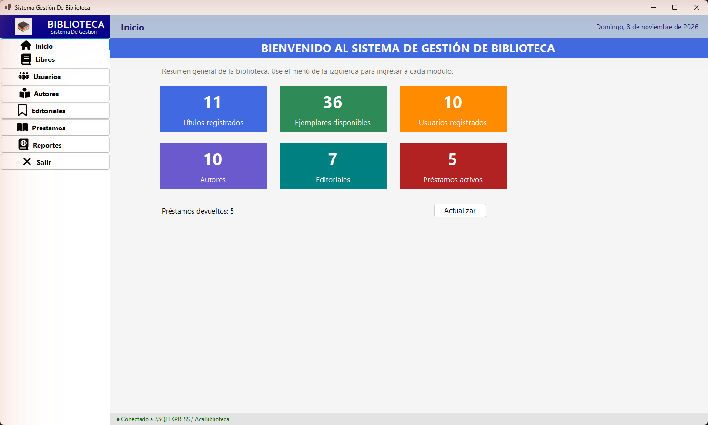

**Descripción:** formulario principal con el menú lateral, la barra superior con el módulo activo y la fecha, la barra inferior con el estado de la conexión y el resumen de la biblioteca.

## 12.2 Gestión de libros

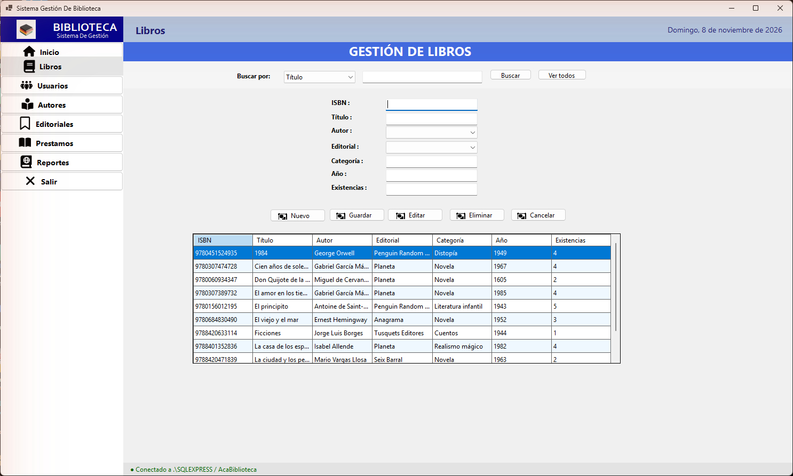

**Descripción:** formulario de libros con la búsqueda por criterio, los datos del libro, los botones de operación y la tabla con autor, editorial y existencias.

## 12.3 Gestión de autores

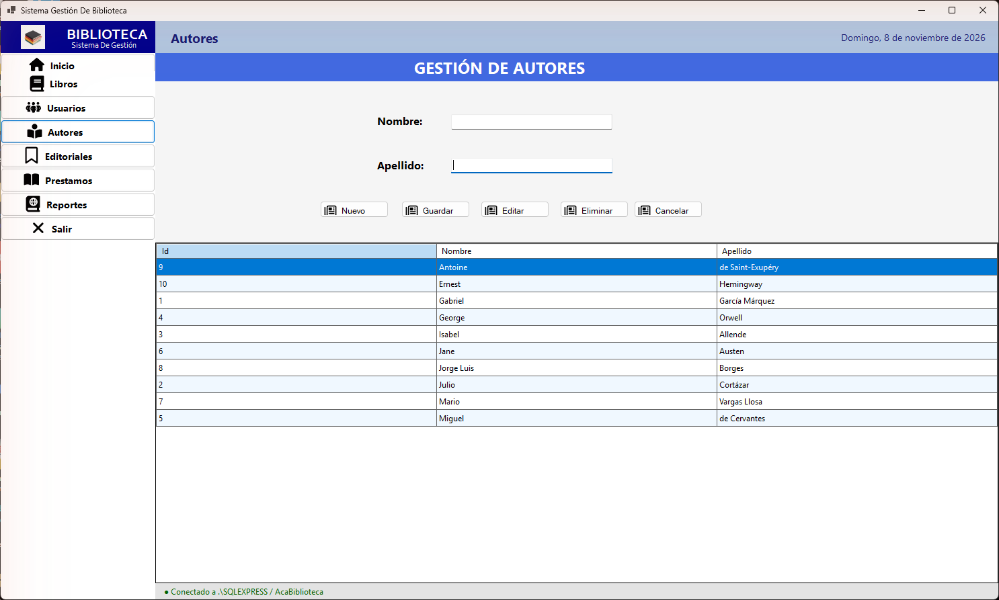

**Descripción:** registro, edición y eliminación de autores.

## 12.4 Gestión de editoriales

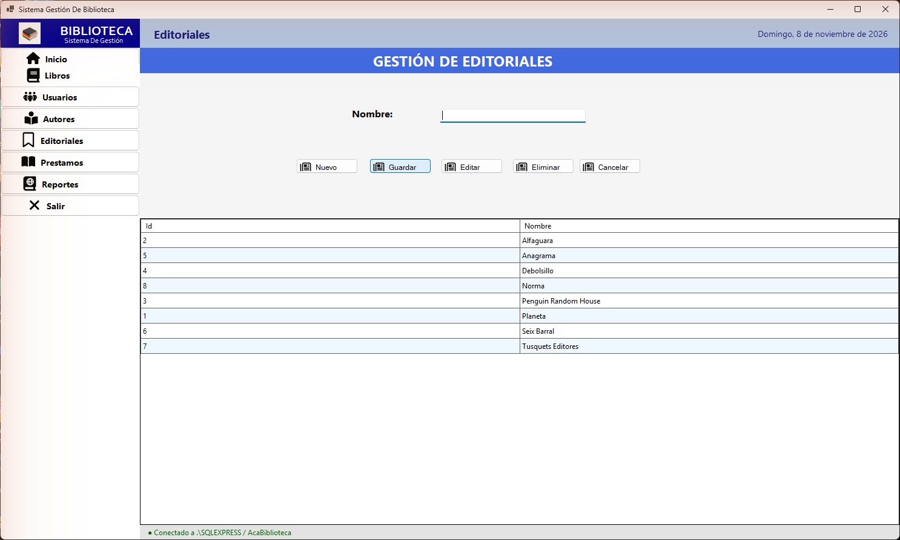

**Descripción:** registro, edición y eliminación de editoriales.

## 12.5 Gestión de usuarios

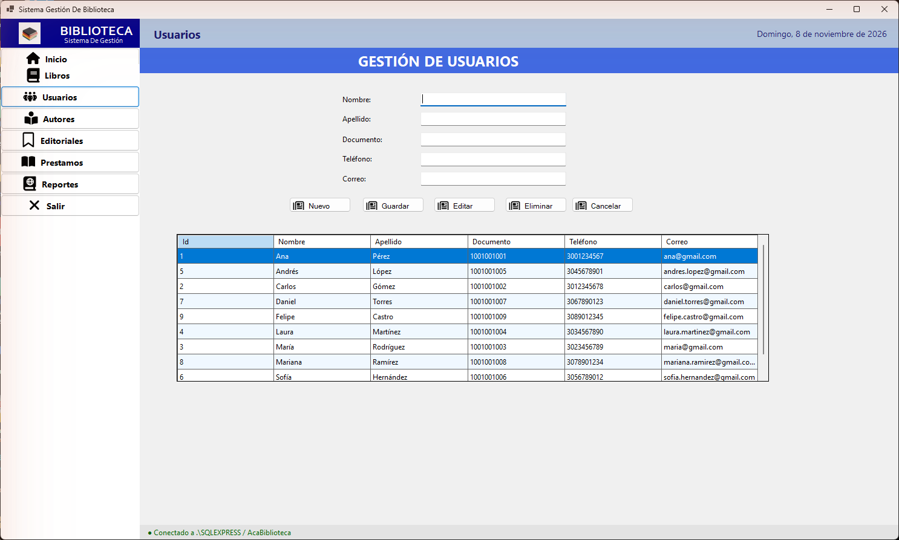

**Descripción:** registro, edición y eliminación de usuarios con documento, teléfono y correo.

## 12.6 Registro de préstamos

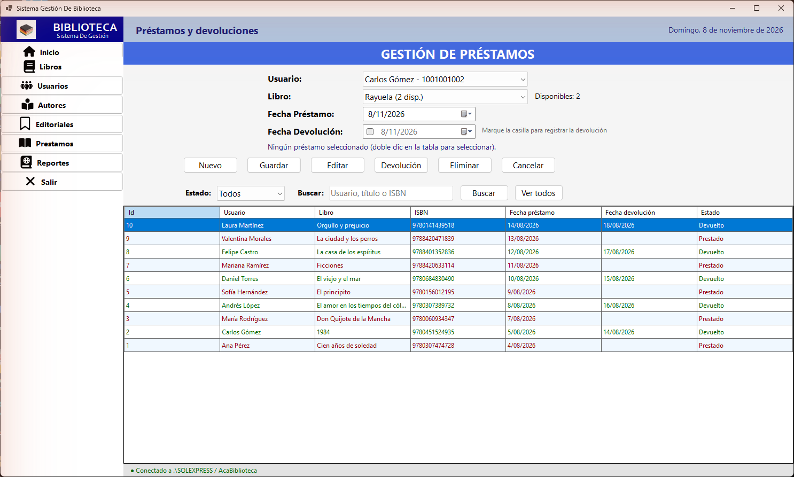

**Descripción:** selección de usuario y libro con sus ejemplares disponibles, fechas, botones de operación, filtros y tabla de préstamos coloreada por estado.

## 12.7 Registro de devoluciones

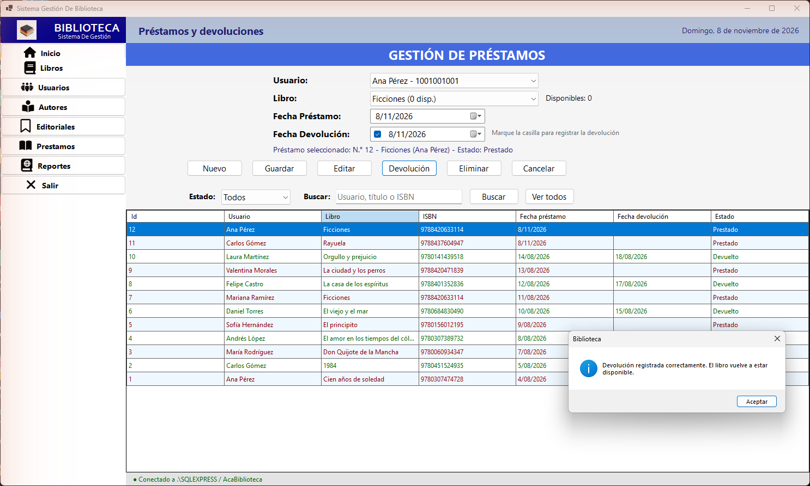

**Descripción:** préstamo seleccionado con la fecha de devolución marcada y el mensaje de confirmación.

## 12.8 Reportes

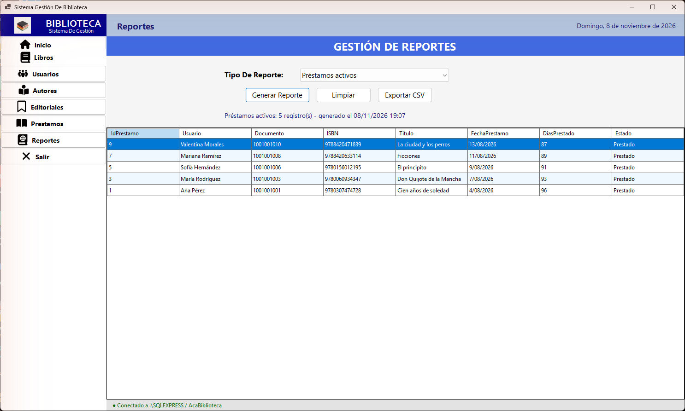

**Descripción:** reporte generado con el número de registros y la opción de exportar a CSV.

------------------------------------------------------------------------

# 13. PRUEBAS DE FUNCIONAMIENTO

## 13.1 Estrategia de pruebas

Se realizaron **pruebas funcionales manuales** (caja negra) sobre la aplicación conectada a la base de datos con los datos de prueba del script. Para cada módulo se probaron los casos válidos y los casos que deben ser rechazados por las validaciones y reglas de negocio. Después de cada operación se verificó el resultado en la tabla del formulario, en el módulo de Inicio y, cuando era necesario, con consultas en SQL Server Management Studio.

## 13.2 Casos de prueba

| ID | Funcionalidad | Entrada / acción | Resultado esperado | Resultado obtenido | Estado |
|---|---|---|---|---|---|
| CP01 | Conexión | Abrir la aplicación con SQL Server encendido | La barra inferior muestra «Conectado a .\SQL2022 / AcaBiblioteca» | Conexión correcta | Aprobado |
| CP02 | Registrar libro | ISBN 9788497592208, título «Crónica de una muerte anunciada», autor García Márquez, editorial Debolsillo, año 1981, existencias 3 | «Libro guardado correctamente» y el libro aparece en la tabla | Libro registrado | Aprobado |
| CP03 | Registrar libro | ISBN repetido 9780451524935 | Advertencia «Ya existe un libro con el ISBN…» | Registro rechazado | Aprobado |
| CP04 | Registrar libro | ISBN «123», año «abc» o existencias «-2» | Advertencia del campo con error | Registro rechazado | Aprobado |
| CP05 | Buscar libro | Criterio Autor, texto «Márquez» | Se listan los libros de Gabriel García Márquez | Búsqueda correcta | Aprobado |
| CP06 | Eliminar libro | Eliminar «1984» (tiene préstamos) | Advertencia: tiene préstamo(s) registrado(s) | Eliminación bloqueada | Aprobado |
| CP07 | Registrar autor | Nombre «Julio», apellido «Cortázar» (ya existe) | Advertencia de autor ya registrado | Registro rechazado | Aprobado |
| CP08 | Eliminar autor | Eliminar a George Orwell (tiene libros) | Advertencia: tiene libro(s) registrado(s) | Eliminación bloqueada | Aprobado |
| CP09 | Registrar editorial | Nombre «Norma» | Editorial registrada | Editorial registrada | Aprobado |
| CP10 | Registrar usuario | Datos válidos, documento 1001001011 | «Usuario guardado correctamente» | Usuario registrado | Aprobado |
| CP11 | Registrar usuario | Documento repetido 1001001001 | Advertencia de documento existente | Registro rechazado | Aprobado |
| CP12 | Registrar usuario | Correo «ana.gmail.com» | Advertencia de formato de correo | Registro rechazado | Aprobado |
| CP13 | Registrar préstamo | Usuario Carlos Gómez, libro «Rayuela» (2 disponibles) | Préstamo registrado y existencias de Rayuela pasan a 1 | Préstamo registrado y existencias actualizadas | Aprobado |
| CP14 | Registrar préstamo | Libro con 0 existencias (se editaron las existencias de «Ficciones» a 0) | Advertencia «No hay existencias disponibles» | Préstamo rechazado | Aprobado |
| CP15 | Registrar préstamo | Ana Pérez + «Cien años de soledad» (ya tiene ese préstamo activo) | Advertencia de préstamo activo repetido | Préstamo rechazado | Aprobado |
| CP16 | Registrar devolución | Préstamo activo, fecha de devolución marcada | Estado «Devuelto», fecha guardada y existencias + 1 | Devolución registrada | Aprobado |
| CP17 | Registrar devolución | Préstamo ya devuelto | Advertencia «Este préstamo ya fue devuelto» | Operación rechazada | Aprobado |
| CP18 | Editar préstamo | Cambiar el libro de un préstamo activo | Existencias: +1 al libro anterior, −1 al nuevo | Existencias ajustadas | Aprobado |
| CP19 | Eliminar préstamo | Eliminar un préstamo activo | Préstamo eliminado y existencia repuesta | Préstamo eliminado | Aprobado |
| CP20 | Reportes | Generar «Préstamos activos» | Se listan los préstamos con estado Prestado y el total | Reporte generado | Aprobado |
| CP21 | Exportar | Exportar un reporte a CSV | Archivo CSV que se abre en Excel | Archivo generado | Aprobado |
| CP22 | Sin conexión | Abrir la aplicación con SQL Server detenido | Mensaje de error controlado, la aplicación no se cierra | Error controlado | Aprobado |

## 13.3 Evidencias de pruebas

### Prueba CP13 – Registro de préstamo

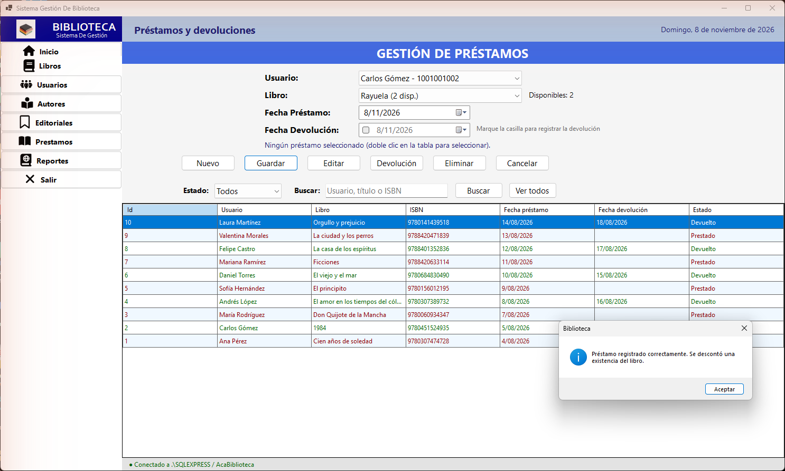

**Resultado:** el préstamo se registró y las existencias del libro disminuyeron en uno.

### Prueba CP14 – Libro sin existencias

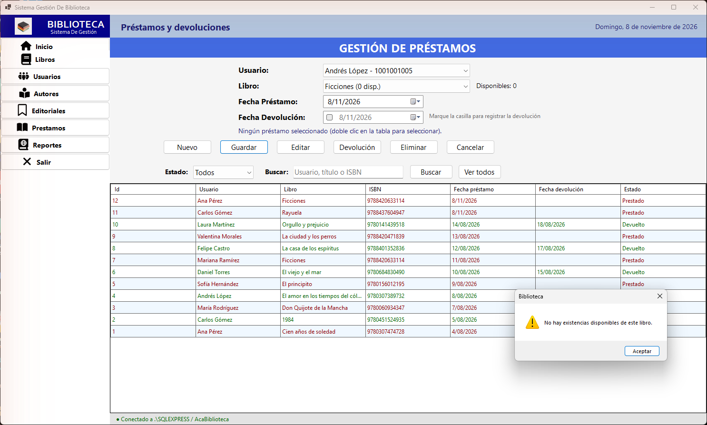

**Resultado:** el sistema no permitió el préstamo y mostró la advertencia.

### Prueba CP16 – Devolución

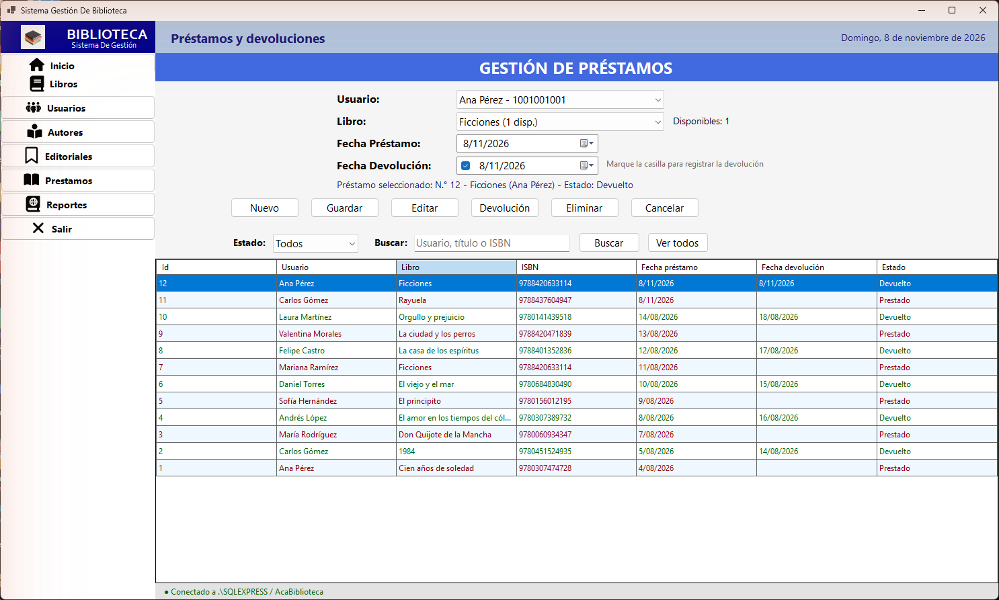

**Resultado:** el préstamo cambió a Devuelto y el ejemplar volvió a estar disponible.

------------------------------------------------------------------------

# 14. CONCLUSIONES

**Conclusión 1.** Se desarrolló un Sistema de Gestión de Biblioteca funcional que cubre los ocho requerimientos funcionales planteados: CRUD de libros, autores, editoriales y usuarios, préstamos, devoluciones, reportes y navegación entre módulos, con información centralizada en SQL Server.

**Conclusión 2.** La Programación Orientada a Objetos permitió modelar el dominio con clases claras y reutilizables. La herencia (`EntidadBase` → `Persona` → `Autor`/`Usuario`, `DaoBase`, `NegocioBase`) evitó repetir código, y el polimorfismo del método `Validar()` permitió validar cualquier entidad con un solo método de la capa de negocio.

**Conclusión 3.** La separación en cuatro proyectos (Presentación, Negocio, Datos y Entidades) hizo que cada parte tenga una única responsabilidad: los formularios quedaron más cortos y legibles que en la versión inicial, en la que el SQL estaba dentro de cada formulario, y cualquier cambio en la base de datos solo afecta a la capa de datos.

**Conclusión 4.** Las restricciones de la base de datos (`UNIQUE`, `CHECK`, claves foráneas) junto con las validaciones de la capa de negocio y las transacciones garantizan la integridad: no es posible tener existencias negativas, préstamos sin usuario o libro, ni préstamos devueltos sin fecha. La principal dificultad fue mantener sincronizadas las existencias del libro con los préstamos; se resolvió ejecutando ambas operaciones en una misma transacción y con la condición `Existencias > 0` en la actualización.

------------------------------------------------------------------------

# 15. RECOMENDACIONES

- **Futuras mejoras:** agregar la fecha estimada de devolución y el cálculo de multas por retraso, y permitir prestar varios libros en un mismo préstamo con una tabla de detalle.
- **Seguridad:** implementar inicio de sesión con roles (administrador y bibliotecario) y guardar la cadena de conexión en un archivo de configuración (`appsettings.json`) en lugar del código.
- **Mantenimiento:** programar copias de seguridad periódicas de la base de datos y agregar pruebas unitarias automáticas a la capa de negocio.
- **Nuevas funcionalidades:** crear una tabla de categorías, reservas de libros, alertas de préstamos vencidos y exportación de reportes a PDF.
- **Escalabilidad:** si la biblioteca crece, migrar a una aplicación web (ASP.NET Core) que reutilice las capas de Negocio, Datos y Entidades.

------------------------------------------------------------------------

# 16. REFERENCIAS BIBLIOGRÁFICAS

Corporación Unificada Nacional de Educación Superior. (2025). *Guías de las temáticas 1 a 6 de Programación Avanzada (ISP01)* [Material de clase]. Escuela de Ingenierías, CUN.

Hernández Bejarano, M. (2020). *Ciclo de vida de desarrollo ágil de software seguro*. Fundación Universitaria Los Libertadores. https://elibro-net.zproxy.cun.edu.co/es/lc/bibliocun/titulos/197008

Microsoft. (s.f.). *CREATE TABLE (Transact-SQL)*. Microsoft Learn. https://learn.microsoft.com/es-es/sql/t-sql/statements/create-table-transact-sql

Microsoft. (s.f.). *Guía de escritorio (Windows Forms .NET)*. Microsoft Learn. https://learn.microsoft.com/es-es/dotnet/desktop/winforms/overview/

Microsoft. (s.f.). *Introducción al espacio de nombres Microsoft.Data.SqlClient*. Microsoft Learn. https://learn.microsoft.com/es-es/sql/connect/ado-net/introduction-microsoft-data-sqlclient-namespace

Price, M. J. (2021). *C# 10 and .NET 6 – Modern cross-platform development: Build apps, websites, and services with ASP.NET Core 6, Blazor, and EF Core 6 using Visual Studio 2022 and Visual Studio Code* (6.ª ed.). Packt Publishing.

Vegas Gertrudix, J. M. (2022). *Java 17: Programación avanzada*. RA-MA.

------------------------------------------------------------------------

# ANEXOS

## Anexo A. Repositorio GitHub

**Repositorio:** https://github.com/johnmorav-dev/ACA-PROGRAMACION-AVANZADA-54469-SEGUNDO-BLOQUE-26V04

## Anexo B. Script de base de datos

**Archivo:** `BaseDatos/AcaBiblioteca.sql` — crea la base de datos, las cinco tablas con sus claves primarias, foráneas y restricciones, los índices y los datos de prueba (10 usuarios, 10 autores, 7 editoriales, 11 libros y 10 préstamos).

## Anexo C. Evidencia de Git y GitHub

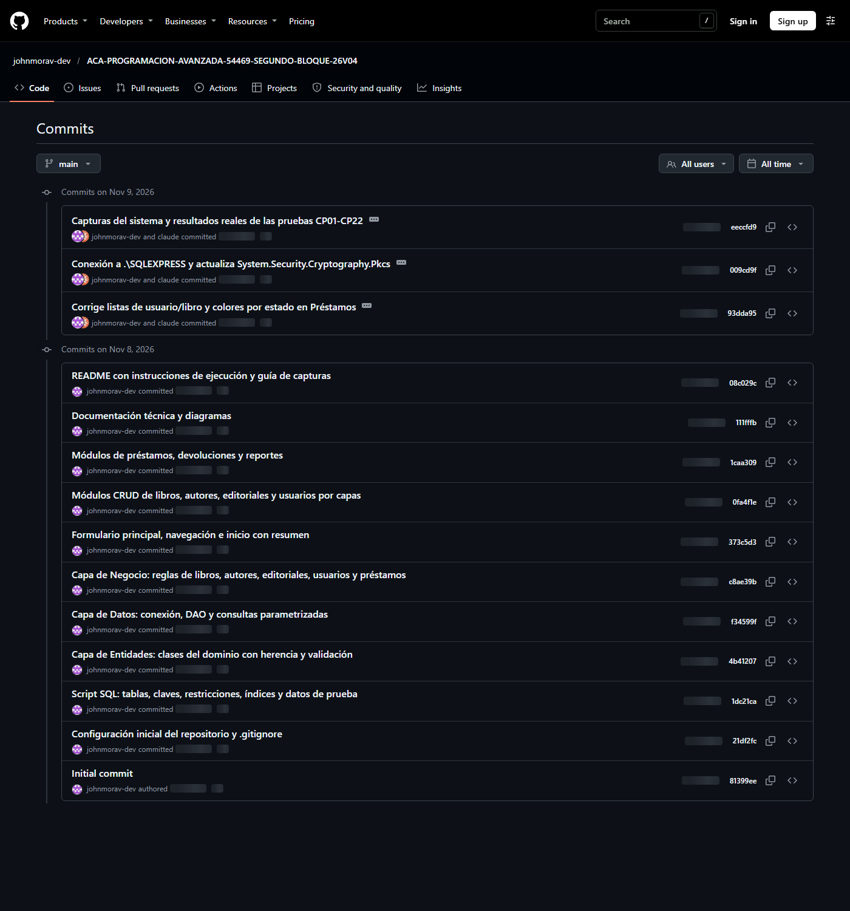

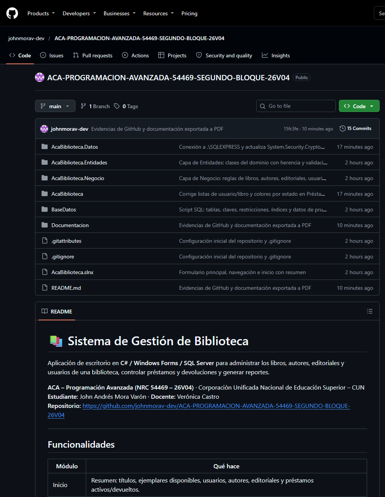
