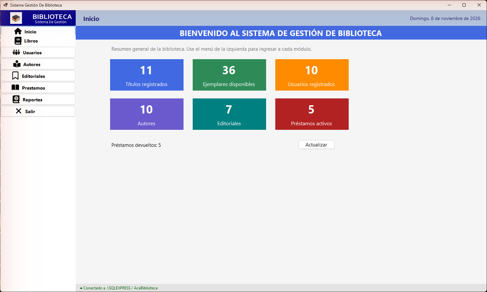
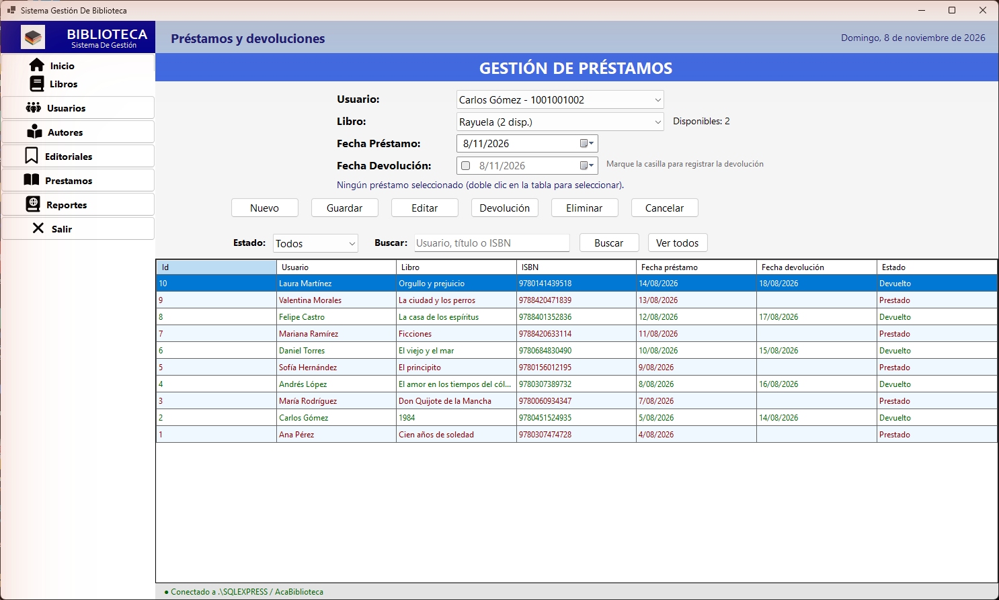
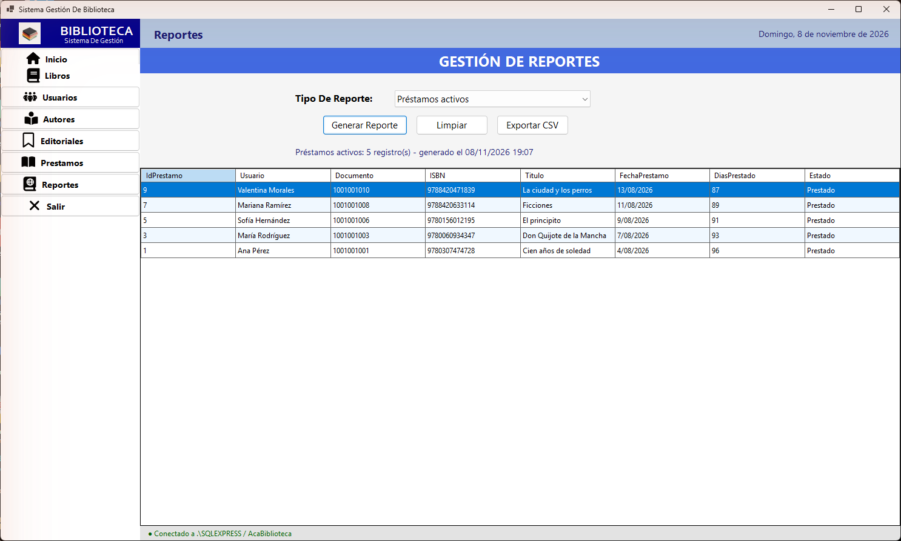

# 📚 Sistema de Gestión de Biblioteca

Aplicación de escritorio en **C# / Windows Forms / SQL Server** para administrar los libros, autores, editoriales y usuarios de una biblioteca, controlar préstamos y devoluciones y generar reportes.

**ACA – Programación Avanzada (NRC 54469 – 26V04)** · Corporación Unificada Nacional de Educación Superior – CUN<br>
**Estudiante:** John Andrés Mora Varón · **Docente:** Verónica Castro<br>
**Repositorio:** https://github.com/johnmorav-dev/ACA-PROGRAMACION-AVANZADA-54469-SEGUNDO-BLOQUE-26V04

---

## Funcionalidades

| Módulo | Qué hace |
|---|---|
| Inicio | Resumen: títulos, ejemplares disponibles, usuarios, autores, editoriales y préstamos activos/devueltos. |
| Libros | CRUD + búsqueda por título, ISBN o autor; relación con autor y editorial; existencias. |
| Autores | CRUD; impide duplicados y eliminar autores con libros. |
| Editoriales | CRUD; impide duplicados y eliminar editoriales con libros. |
| Usuarios | CRUD; documento único, validación de correo y teléfono. |
| Préstamos | Registrar, editar, eliminar y **devolver**; controla existencias con transacciones; filtro por estado y búsqueda. |
| Reportes | 10 reportes (activos, devueltos, historial, inventario, más prestados…) con exportación a CSV. |

## Tecnologías

- C# · .NET 10 · Windows Forms
- SQL Server 2022 · ADO.NET (`Microsoft.Data.SqlClient`)
- FontAwesome.Sharp (íconos del menú)
- Visual Studio · Git y GitHub

## Arquitectura por capas

```text
AcaBiblioteca.slnx
├── AcaBiblioteca/             → Presentación (formularios Windows Forms)
├── AcaBiblioteca.Negocio/     → Lógica de negocio (reglas y validaciones)
├── AcaBiblioteca.Datos/       → Acceso a datos (conexión, DAO, consultas parametrizadas)
├── AcaBiblioteca.Entidades/   → Clases del dominio (POO)
├── BaseDatos/AcaBiblioteca.sql
└── Documentacion/             → Documento técnico, diagramas y capturas
```

Presentación → Negocio → Datos → SQL Server. Los formularios no contienen SQL; las reglas viven en la capa de negocio.

---

## Instrucciones de ejecución

### Requisitos

- Windows 10/11
- Visual Studio 2026 (o 2022 actualizado) con la carga de trabajo **Desarrollo de escritorio con .NET** y el SDK de **.NET 10**
- SQL Server 2022 Express (instancia `SQLEXPRESS`) y SQL Server Management Studio

### 1. Crear la base de datos

1. Abra **SSMS** y conéctese a `.\SQLEXPRESS` (autenticación de Windows, *Certificado de servidor de confianza* marcado).
2. Abra `BaseDatos/AcaBiblioteca.sql` y ejecútelo completo con **F5**.
3. Al final debe ver el conteo de registros: 10 autores, 7 editoriales, 11 libros, 10 usuarios y 10 préstamos.

> ⚠️ El script elimina y vuelve a crear la base `AcaBiblioteca` para dejarla en un estado limpio.

### 2. Configurar la conexión (solo si su instancia es diferente)

La cadena está en `AcaBiblioteca.Datos/Conexion.cs`:

```csharp
"Server=.\\SQLEXPRESS;Database=AcaBiblioteca;Integrated Security=true;TrustServerCertificate=true;"
```

Si usa otra instancia cambie `.\SQLEXPRESS`: por ejemplo `.\SQL2022` o, para la instancia predeterminada, `localhost`.

### 3. Ejecutar

1. Abra `AcaBiblioteca.slnx` en Visual Studio.
2. Visual Studio restaura los paquetes NuGet (`Microsoft.Data.SqlClient` y `FontAwesome.Sharp`) automáticamente. Si no lo hace: clic derecho sobre la solución → **Restaurar paquetes NuGet**.
3. Verifique que **AcaBiblioteca** sea el proyecto de inicio (clic derecho → *Establecer como proyecto de inicio*).
4. Presione **F5**. En la barra inferior debe aparecer «● Conectado a .\SQLEXPRESS / AcaBiblioteca».

### Uso rápido

- **Guardar** registra un registro nuevo.
- **Doble clic** en una fila de la tabla carga el registro; luego use **Editar** o **Eliminar**.
- **Nuevo / Cancelar** limpian el formulario.
- En Préstamos, para devolver: doble clic en el préstamo → marque **Fecha Devolución** → **Devolución**.

---

## Capturas

| Inicio | Préstamos | Reportes |
|---|---|---|
|  |  |  |

## Documentación

- [Documento técnico](Documentacion/Documentacion.md)
- [Modelo entidad-relación](Documentacion/img/modelo-entidad-relacion.png)
- [Diagrama de clases](Documentacion/img/diagrama-clases-entidades.png)
- [Arquitectura](Documentacion/img/diagrama-arquitectura.png)

### Exportar la documentación a PDF (con numeración de páginas)

En Visual Studio Code instale la extensión **Markdown PDF** (yzane), abra `Documentacion/Documentacion.md` y agregue a la configuración (`settings.json`):

```json
"markdown-pdf.displayHeaderFooter": true,
"markdown-pdf.headerTemplate": "<div></div>",
"markdown-pdf.footerTemplate": "<div style='font-size:9px;width:100%;text-align:center;'><span class='pageNumber'></span> / <span class='totalPages'></span></div>"
```

Luego: clic derecho en el documento → **Markdown PDF: Export (pdf)**.
